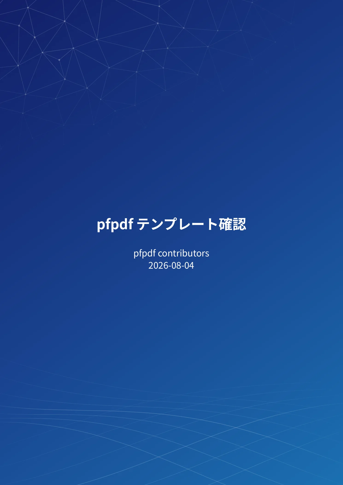
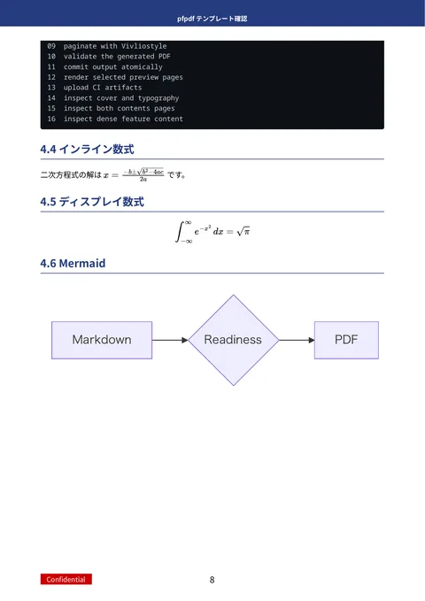
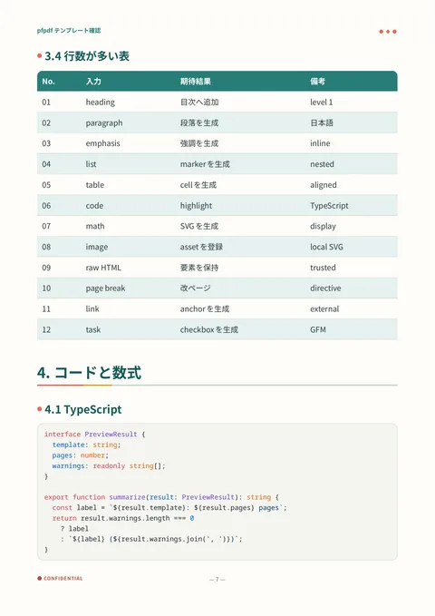

# pfpdf

pfpdfは、Markdown文書から日本語組版に対応したPDFを生成するコマンドラインツールです。表紙や目次を付けた技術レポート、マニュアルなどを作れます。表・数式・コードハイライトにも対応しています。

[English](README.md) · [ウェブサイト](https://pfpdf.preferred.tech/ja/) · [チュートリアル](docs/tutorial.ja/)

<p>
  <a href="https://pfpdf.preferred.tech/ja/gallery/pfn/"></a>
  <a href="https://pfpdf.preferred.tech/ja/gallery/pfn/"></a>
  <a href="https://pfpdf.preferred.tech/ja/gallery/notebook/"></a>
</p>

左から、`pfn`の表紙、数式と図を含む本文、`notebook`の表とコードの例です。[テンプレートギャラリー](https://pfpdf.preferred.tech/ja/gallery/)で各テンプレートの出力を確認できます。

## クイックスタート

Node.js 22.12.0以上とnpmが必要です。pfpdfをあらかじめインストールする必要はありません。

次の内容を`document.md`に保存します。

```markdown
---
title: 技術レポート
template: pfn
---

# 概要

これは **pfpdf** で作るPDFです。

## 数式

$$
E = mc^2
$$
```

次のコマンドで、表紙と本文を含む`document.pdf`を生成できます。

```bash
npx @pfnet-research/pfpdf@latest --input document.md --output document.pdf
```

初回はPDFの描画に使うChromiumを自動でダウンロードするため、数百MBの通信が発生することがあります。2回目以降は保存済みのブラウザーを使います。

複数のファイルをまとめる場合は、`--input`にディレクトリーを指定します。直下の`*.md`ファイルをファイル名順に結合し、1つのPDFを生成します。

```bash
npx @pfnet-research/pfpdf@latest --input docs --output docs.pdf
```

CIなどで同じバージョンを使い続ける場合は、`@latest`を`@0.2.1`のようなバージョン指定に置き換えてください。

## 主な機能

- GitHub Flavored Markdown（GFM）の表、タスクリスト、取り消し線などに対応しています。日本語の句読点や括弧に隣接する強調も扱えます。
- 数式、コードハイライト、Mermaidの図を文書に組み込めます。描画に必要なアセットは同梱しています。
- 表紙、目次、改ページに対応し、BibTeXファイルから引用と参考文献一覧を生成できます。
- 7種類のテンプレートを同梱しています。文書先頭の設定欄（フロントマター）やコマンドライン引数で選択でき、独自のテンプレートやロゴも指定できます。
- 再配布可能なフォントを同梱しているため、既定ではOSのフォントに依存しません。必要に応じて手元のフォントも使えます。

文書の描画には[Vivliostyle CLI](https://github.com/vivliostyle/vivliostyle-cli)とChromiumを使います。各機能の記法や設定は[チュートリアル](docs/tutorial.ja/)を参照してください。

## 想定環境

- macOS aarch64（Apple Silicon）
- Linux x86_64
- Windows x86_64
- Linux aarch64

いずれの環境でも、CIで実際のブラウザーを使ってPDFの生成を検証しています。

LinuxではChromiumの実行に追加のシステムライブラリーが必要です。環境に問題がある場合は、次のコマンドで診断できます。

```bash
npx @pfnet-research/pfpdf@latest --doctor
```

必要なパッケージやエラーへの対処方法は[トラブルシューティング](docs/tutorial.ja/08_troubleshooting.md)を参照してください。

## 入力文書の取り扱い

pfpdfには、信頼できる文書を入力してください。入力に含まれるHTMLをそのまま描画し、スクリプトも実行します。文書からは、pfpdfが読み取れるローカルファイルや外部のURLにアクセスできます。入力の無害化や隔離は行いません。

リモートの画像などを参照する文書では、変換時にそれらを取得できる必要があります。詳細と脆弱性の報告方法は[セキュリティーポリシー](SECURITY.md)を参照してください。

## ドキュメント

| 文書 | 日本語 | 英語 |
|---|---|---|
| チュートリアル | [docs/tutorial.ja/](docs/tutorial.ja/) | [docs/tutorial.en/](docs/tutorial.en/) |
| 設計書 | [docs/design.ja/](docs/design.ja/) | [docs/design.en/](docs/design.en/) |

仕様と使い方は日本語版を基準とし、英語版はその翻訳です。PDF版は各GitHub Releaseに添付しています。手元で生成する場合は`make docs`を実行してください。

開発への参加方法は[コントリビューションガイド](CONTRIBUTING.md)にまとめています。

## ライセンス

pfpdfのコードは[MIT License](LICENSE)で公開しています。同梱・依存するソフトウェアやフォントには、それぞれのライセンスが適用されます。Vivliostyle CLIのAGPL-3.0を含む一覧は[第三者ライセンス](THIRD_PARTY_LICENSES.md)を参照してください。
