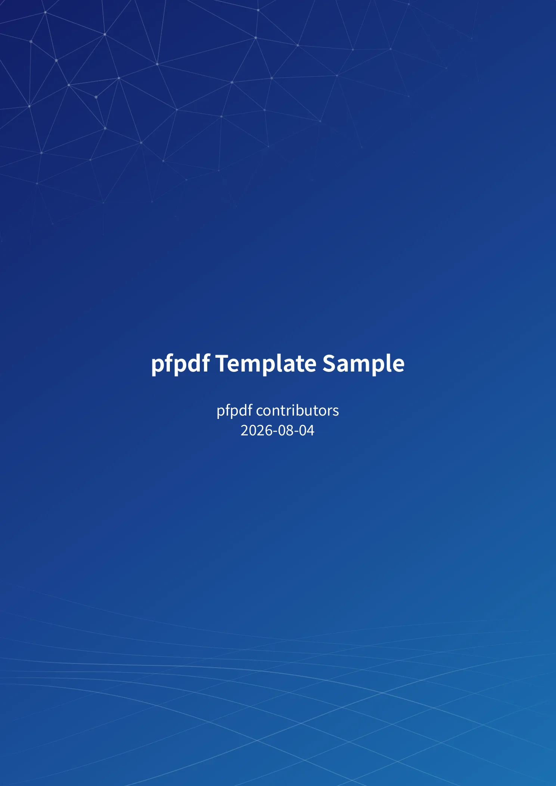
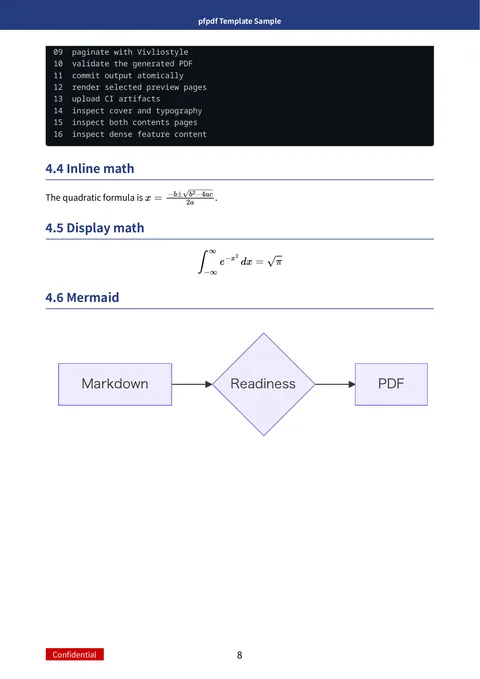
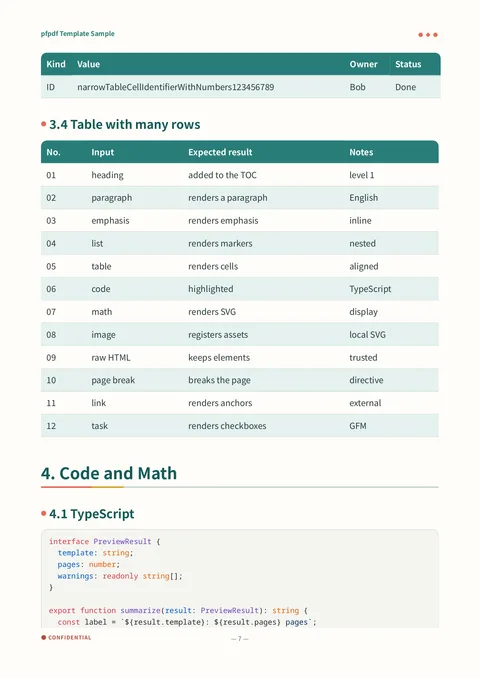

# pfpdf

pfpdf is a command-line tool that converts Markdown documents into PDFs with
support for Japanese typesetting. Use it to create technical reports and manuals
with cover pages, tables of contents, equations, and highlighted code.

[日本語](README.ja.md) · [Website](https://pfpdf.preferred.tech/) · [Tutorial](docs/tutorial.en/)

<p>
  <a href="https://pfpdf.preferred.tech/gallery/pfn/"></a>
  <a href="https://pfpdf.preferred.tech/gallery/pfn/"></a>
  <a href="https://pfpdf.preferred.tech/gallery/notebook/"></a>
</p>

From left: a `pfn` cover, a `pfn` page with equations and a diagram, and a
`notebook` page with a table and code. See the
[template gallery](https://pfpdf.preferred.tech/gallery/) for more samples.

## Quick start

You need Node.js 22.12.0 or later and npm. You can run pfpdf without installing
it first.

Save the following as `document.md`:

```markdown
---
title: Technical report
template: pfn
---

# Overview

This PDF is generated with **pfpdf**.

## Equation

$$
E = mc^2
$$
```

Generate `document.pdf`, including a cover and body pages:

```bash
npx @pfnet-research/pfpdf@latest --input document.md --output document.pdf
```

On the first run, pfpdf automatically downloads Chromium for PDF rendering. The
download may be several hundred megabytes. Later runs use the cached browser.

To combine multiple files, pass a directory to `--input`. pfpdf reads the `*.md`
files directly inside it in filename order and produces a single PDF:

```bash
npx @pfnet-research/pfpdf@latest --input docs --output docs.pdf
```

For CI or other workflows that need a fixed version, replace `@latest` with a
version such as `@0.2.1`.

## Features

- GitHub Flavored Markdown (GFM) tables, task lists, strikethrough, and more.
  Emphasis also works next to Japanese full-width punctuation.
- Equations, syntax highlighting, and Mermaid diagrams, with bundled rendering
  assets.
- Cover pages, tables of contents, page breaks, and citations and reference lists
  generated from BibTeX files.
- Seven bundled templates, selectable through front matter or command-line
  arguments. You can also provide custom templates and logos.
- Redistributable bundled fonts, so the default output does not depend on OS
  fonts. You can opt into local fonts when needed.

Rendering uses [Vivliostyle CLI](https://github.com/vivliostyle/vivliostyle-cli)
and Chromium. See the [tutorial](docs/tutorial.en/) for syntax and configuration.

## Target environments

- macOS aarch64 (Apple Silicon)
- Linux x86_64
- Windows x86_64
- Linux aarch64

CI verifies PDF generation with a real browser in all four environments.

On Linux, Chromium requires additional system libraries. To diagnose problems
with your environment, run:

```bash
npx @pfnet-research/pfpdf@latest --doctor
```

See [troubleshooting](docs/tutorial.en/08_troubleshooting.md) for required
packages and solutions to common errors.

## Input documents

Use pfpdf with trusted documents. The browser renders HTML and executes scripts
in the input as-is. Documents can access local files readable by pfpdf and fetch
external URLs. pfpdf does not sanitize or sandbox input.

Documents that reference remote images or other resources need those resources
to be available during conversion. See the [security policy](SECURITY.md) for
details and vulnerability reporting.

## Documentation

| Document | Japanese | English |
|---|---|---|
| Tutorial | [docs/tutorial.ja/](docs/tutorial.ja/) | [docs/tutorial.en/](docs/tutorial.en/) |
| Design | [docs/design.ja/](docs/design.ja/) | [docs/design.en/](docs/design.en/) |

The Japanese documentation is the source for the specification and usage;
English versions are translations. PDFs are attached to each GitHub Release.
Run `make docs` to build them locally.

See the [contribution guide](CONTRIBUTING.md) for development instructions.

## License

pfpdf code is released under the [MIT License](LICENSE). Bundled software,
dependencies, and fonts have their own licenses. See
[third-party licenses](THIRD_PARTY_LICENSES.md) for the full list, including
AGPL-3.0 for Vivliostyle CLI.
