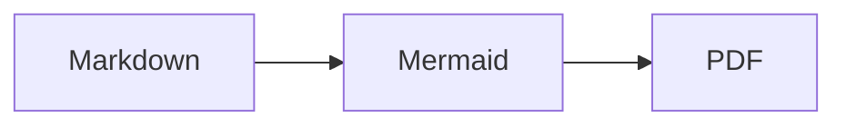
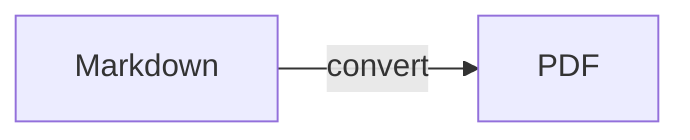
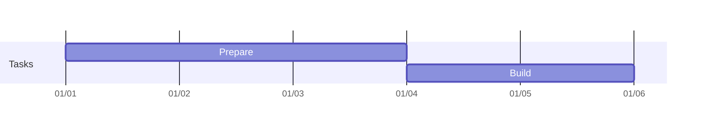

# 5. Math, Code Highlighting, and Mermaid Diagrams

pfpdf bundles the files needed for math, syntax highlighting, and Mermaid diagrams. After the initial browser download, these features work without network access.

## 5.1 Inline math

Enclose a TeX expression in `$...$` to display it within a line of text. Do not put whitespace immediately after the opening `$` or immediately before the closing `$`, and do not let the expression span a line break.

```md
The solutions of a quadratic equation are $x = \frac{-b \pm \sqrt{b^2 - 4ac}}{2a}$.
```

The solutions of a quadratic equation are $x = \frac{-b \pm \sqrt{b^2 - 4ac}}{2a}$.

## 5.2 Display math

Enclose an expression between `$$` delimiters, each on its own line, to display it on a separate line. A delimiter on the same line as the expression does not start a display-math block.

```md
$$
\int_{-\infty}^{\infty} e^{-x^2} \, dx = \sqrt{\pi}
$$
```

$$
\int_{-\infty}^{\infty} e^{-x^2} \, dx = \sqrt{\pi}
$$

If the closing `$$` is missing, no math block is started and the content is treated as regular text. If MathJax reports a TeX syntax error while typesetting an equation, pfpdf fails with exit code `2` without leaving a PDF containing the broken math.

## 5.3 A `$` that should not become math

To keep a `$` in ordinary prose from becoming math, escape it as `\$`.

```md
The price is \$100.
```

## 5.4 Code highlighting

Add a language name after the opening fence of a code block to enable syntax highlighting.

````md
```python
def greet(name: str) -> str:
    return f"Hello, {name}!"
```
````

```python
def greet(name: str) -> str:
    return f"Hello, {name}!"
```

For TypeScript, use `typescript`.

```typescript
export function add(a: number, b: number): number {
  return a + b;
}
```

If you omit the language name, you get a plain code block without highlighting. If you specify an unknown language name, the code itself is kept and displayed as plain text, and a warning is emitted.

```
a plain text block
```

## 5.5 Mermaid diagrams

A fenced code block with the language name `mermaid` is rendered as a diagram. The Mermaid runtime itself is bundled with pfpdf, so no CDN connection is required.

The following example connects three boxes—Markdown, Mermaid, and PDF—with arrows from left to right.

````md

````


pfpdf renders Mermaid diagrams to SVG during Markdown conversion and stores each SVG as a standalone image in the build workspace. Vivliostyle places the image on the page in vector form.

If a diagram contains a syntax error, pfpdf reports the source file and line and exits with code `2` instead of placing unrendered source in the PDF. A failure to load the bundled Mermaid runtime produces exit code `1`.

Diagrams are laid out with ELK by default. To use another layout such as dagre for a diagram, specify it in the front matter inside that Mermaid code block. Only that diagram uses the specified layout.

````md

````

pfpdf measures label text with the bundled font before laying it out. This includes flowchart arrow labels, as in `A -->|label| B`, and Japanese labels with `<br/>` line breaks.

A diagram is never split across pages, so it is scaled down to fit the body area of one page. If a tall diagram makes its text too small, change its direction, for example to `flowchart LR`, or split it into several diagrams.

Gantt diagrams can also be rendered. The default drawing width is 1200px. Set `config.gantt.useWidth` in the diagram's front matter to change it; the following example uses 800px. The PDF scales the image to fit the body width, so reduce the drawing width if the text is too small.



## 5.6 Markdown notation inside code

Except for `mermaid` blocks converted to diagrams, notation such as `**strong**`, `$math$`, raw HTML, and `___` is not interpreted inside code blocks or inline code. You can use code to explain the notation itself.
