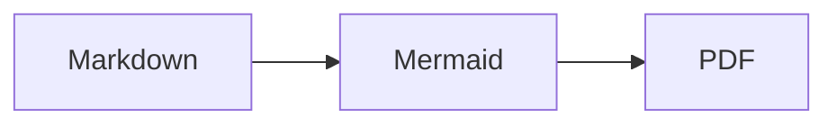
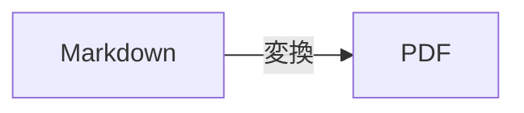
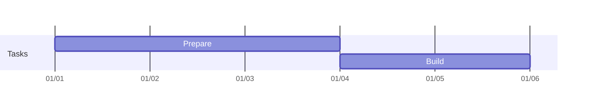

# 5. 数式・コードハイライト・Mermaid 図

数式、コードハイライト、Mermaid 図に必要なファイルは pfpdf のパッケージに同梱されています。初回のブラウザー取得が済んでいれば、ネットワークなしで動作します。

## 5.1 行内数式

TeX 記法の式を `$...$` で囲むと、本文の行内に数式を表示できます。開始の `$` の直後と終了の `$` の直前には空白を置かず、改行をまたがないようにします。

```md
二次方程式の解は $x = \frac{-b \pm \sqrt{b^2 - 4ac}}{2a}$ です。
```

二次方程式の解は $x = \frac{-b \pm \sqrt{b^2 - 4ac}}{2a}$ です。

## 5.2 別行立ての数式

`$$` をそれぞれ単独行に置いて式を囲むと、本文から独立した行に数式を表示できます。区切りの `$$` と式を同じ行に書いても、別行立ての数式にはなりません。

```md
$$
\int_{-\infty}^{\infty} e^{-x^2} \, dx = \sqrt{\pi}
$$
```

$$
\int_{-\infty}^{\infty} e^{-x^2} \, dx = \sqrt{\pi}
$$

閉じる `$$` がない場合は数式を開始せず、通常のテキストとして扱われます。数式の組版に使う MathJax が TeX の構文エラーを報告した場合は、誤った数式を含む PDF を残さず、終了コード `2` で失敗します。

## 5.3 数式にしたくない `$`

通常の文章中に `$` をそのまま表示したい場合は、バックスラッシュを付けて `\$` と書きます。

```md
価格は \$100 です。
```

## 5.4 コードハイライト

コードブロックの開始行に言語名を指定すると、構文に応じてコードが色分けされます。

````md
```python
def greet(name: str) -> str:
    return f"Hello, {name}!"
```
````

```python
def greet(name: str) -> str:
    return f"Hello, {name}!"
```

TypeScript の場合は `typescript` を指定します。

```typescript
export function add(a: number, b: number): number {
  return a + b;
}
```

言語名を省略すると、コードは色分けせずに表示されます。未知の言語名を指定した場合は警告が出ますが、コードの内容は残り、色分けせずに表示されます。

```
plain text のブロック
```

## 5.5 Mermaid 図

コードブロックの言語名に `mermaid` を指定すると、図として描画されます。Mermaid 本体は pfpdf に同梱されているため、CDN への接続は不要です。

次の例では、Markdown、Mermaid、PDF の順に、3 つの箱を左から右へ矢印でつなぎます。

````md

````


Mermaid の図は Markdown 変換時に SVG へ描画され、ビルド用の作業ディレクトリーに独立した画像として保存されます。Vivliostyle はこの画像をベクター形式のままページに配置します。

Mermaid の構文エラーがある場合は、未描画のソースコードを PDF に残さず、ソースファイル名と行番号を表示して終了コード `2` で失敗します。同梱する実行環境自体の読み込みに失敗した場合は、終了コード `1` です。

図の配置には、既定で ELK を使います。dagre など別の配置を使う場合は、Mermaid コードブロック内のフロントマターで指定します。設定はその図にだけ適用されます。

````md

````

フローチャートで `A -->|label| B` のように矢印に付けるラベルや、`<br/>` で改行した日本語のラベルも、同梱フォントで文字の寸法を測って配置します。

図はページをまたいで分割されないため、1 ページの本文領域に収まるよう縮小されます。縦に長い図で文字が小さくなりすぎる場合は、`flowchart LR` のように向きを変えるか、図を分けます。

ガントチャートも描画できます。描画幅は既定で 1200px です。図のフロントマターの `config.gantt.useWidth` で変更でき、次の例では 800px を指定しています。PDF では本文幅に合わせて縮小されるため、文字が小さい場合は描画幅を小さくします。



## 5.6 コード内の Markdown 記法

図に変換する `mermaid` ブロックを除き、コードブロックとインラインコードの中では、`**strong**`、`$math$`、生の HTML、`___` などの記法は解釈されません。記法そのものを説明するときに使えます。
